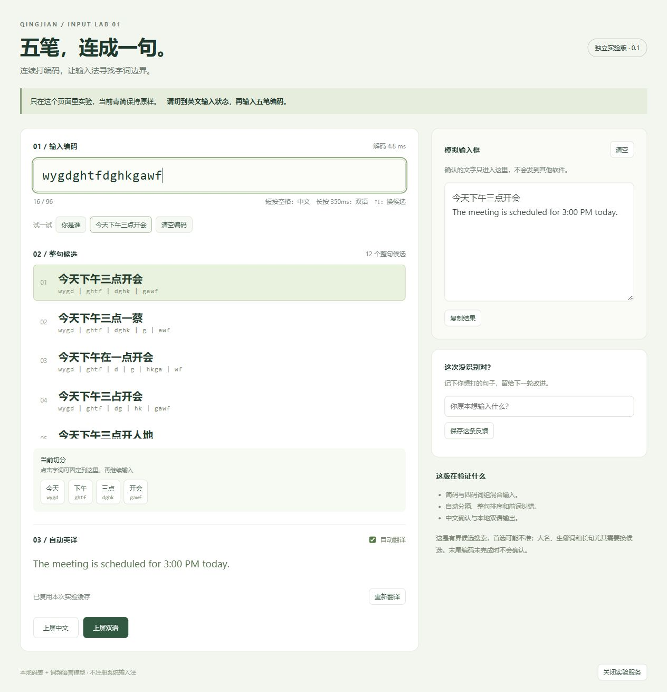

# 五笔整句实验台

独立的 Windows 本地实验程序：连续输入五笔编码，展示自动切分、整句候选和英语翻译。它不注册输入法，不替换已安装青简，确认结果仅进入网页内的模拟输入框。



## 构建与运行

使用仓库要求的 Rust 工具链。在仓库根目录执行：

```powershell
# 从已有青简安装复制语言模型；只写实验目录下的 data/
powershell -NoProfile -ExecutionPolicy Bypass -File experiments/wubi-sentence-lab/scripts/prepare-data.ps1

# 也可以给出自行准备的 lm.qj
# powershell -File experiments/wubi-sentence-lab/scripts/prepare-data.ps1 -LanguageModel D:/qingjian-data/lm.qj

cargo run --release --locked --manifest-path experiments/wubi-sentence-lab/Cargo.toml -- --root experiments/wubi-sentence-lab
```

运行需要 `data/wubi.tsv` 和 `data/lm.qj`。准备脚本从本仓库码表和指定模型复制它们；模型不随源码上传。青简数据构建说明见[上游工程记录](../../docs/notes/crate-notes.md)。

英语翻译调用本机 Ollama：`http://127.0.0.1:11434`，模型 `translategemma:4b`。请自行安装 Ollama 并准备模型。未运行模型时仍能验证中文解码。

程序在浏览器打开本地实验台。再次启动会复用已核验的实验服务；页面底部的“关闭实验服务”退出后台进程。命令行 `--no-open` 只启动服务，`--jsonl` 使用标准输入/输出做离线解码。

## 使用

先切到英文输入状态，再在实验台输入框中输入连续编码：

- `wqjywyg` → `wq｜j｜ywyg` → 你是谁。
- `wygdghtfdghkgawf` → 今天下午三点开会。
- 短按空格确认中文；按住约 350 毫秒确认中英双语。
- 翻译尚未完成时会等待，`Esc` 取消待提交状态，保留编码。
- 方向键或鼠标换整句候选；点击切分字词可固定此前的正确部分。
- “保存反馈”只在实验目录写入 `实验反馈.jsonl`，不会改变现用词库。

## 验证

```powershell
# 不需要模型文件的单元和 HTTP 回归测试
cargo test --locked --manifest-path experiments/wubi-sentence-lab/Cargo.toml
cargo clippy --locked --manifest-path experiments/wubi-sentence-lab/Cargo.toml --all-targets -- -D warnings

# 需先准备数据并构建 release
python experiments/wubi-sentence-lab/scripts/evaluate.py
```

`tests/cases.json` 保留了首轮 33 条人工编码用例，包括简码与单字全码。原实验中 30 条目标句排第一，全部出现在前 12 个候选；这不是通用准确率，也没有针对这些句子写死答案。

## 算法和边界

每个编码位置尝试 1–4 码，码表中的精确字词构成路径；词频及青简二元语言模型负责排序。每位置最多保留 96 条路径，每个码最多考虑 32 个词目，最终最多展示 12 个候选。

输入上限为 96 个字母。生僻字、人名、长句和有歧义的简码可能需要换候选。暂不自动纠正错误编码；翻译只处理已选中文，不参与猜测五笔编码。

正式输入法集成位于 `crates/qingjian-core/src/code_sentence/` 及 Windows Server。实验台保留独立搜索实现，便于回放比较；系统输入法的配置与测试说明见[定制开发说明](../../CUSTOM_BUILD.md)。

码表源自极点86五笔（Apache-2.0），词频和模型来自青简；许可证保留在 `licenses/` 与仓库根目录。个人配置、服务运行信息、反馈及模型文件不进入版本控制。
